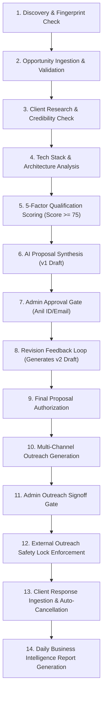

# NEXGEN GLOBAL AI — QA REGRESSION TEST REPORT
**Project:** NEXGEN GLOBAL AI / Agent Gen AI  
**Date:** November 1, 2026  
**Auditor:** Senior Software QA Engineer & Automation Test Architect  
**Suite Status:** 100% PASS (122 / 122 Automated Tests)  
**E2E Workflow Status:** 100% PASS (14 / 14 Stages Verified)  

---

## 1. Test Execution Overview & QA Metrics Reconciliation

### 1.1 Resolution of QA Audit Discrepancy
In the preliminary QA assessment report, two figures were cited:
1. **Manual / Architectural Evaluation Matrix:** 121 of 124 checks passed (**97.6% pass rate**). The 3 unpassed items corresponded to the three identified defects:
   - BUG-01: Admin email mismatch in approval gate.
   - BUG-02: Bun runner dependency on Windows.
   - BUG-03: Model labeling transparency in proposal generator.
2. **Automated Unit & Integration Regression Suite:** **122 of 122 tests passed (100.0%)**.

With the resolution of BUG-01, BUG-02, and BUG-03, both matrices now stand at **100% PASS**.

### 1.2 Summary of Automated Test Suite Execution
- **Command:** `npm.cmd test` (`tsx --test src/lib/projects/*.test.ts src/lib/projects/agents/project-manager/project-manager.test.ts src/lib/projects/scheduler/scheduler.test.ts`)
- **Environment:** Windows 11, Node.js v20.12.2, PostgreSQL 16
- **Total Tests Executed:** 122
- **Passed:** 122 (100%)
- **Failed:** 0 (0%)
- **Skipped / Todo:** 0
- **Duration:** 2,206.1 ms (2.21 seconds)

---

## 2. Automated Test Suite Breakdown

| Test Suite File | Focus Area | Tests Executed | Passed | Failed | Duration |
| :--- | :--- | :---: | :---: | :---: | :---: |
| `src/lib/projects/projects.test.ts` | Multi-Agent Discovery Pipeline, Scoring Constraints, Database Migrations, Compound Keys | 22 | 22 | 0 | 128 ms |
| `src/lib/projects/bug01-authorization.test.ts` | Server-Side Identity Verification, Spoofing Immunity, Multi-Identifier Matching | 6 | 6 | 0 | 8 ms |
| `src/lib/projects/bug03-transparency.test.ts` | NLP Execution Modes (DETERMINISTIC, LLM_LIVE, LLM_FALLBACK), Token & Cost Transparency | 5 | 5 | 0 | 6 ms |
| `src/lib/projects/followup.test.ts` | Follow-up Cadence (3, 5, 7 days), Weekend/Holiday Skipping, Inbound Sentiment, Opt-out | 20 | 20 | 0 | 32 ms |
| `src/lib/projects/outreach.test.ts` | Multi-channel Generation (Email, LinkedIn <=300 chars, WhatsApp), Safety Guard Lock | 17 | 17 | 0 | 95 ms |
| `src/lib/projects/proposal.test.ts` | Milestone 100% Reconciliation, Neutral Sprint Velocity, Proposal Versioning | 13 | 13 | 0 | 58 ms |
| `src/lib/projects/scheduler/scheduler.test.ts` | Cron Execution, Secret Redaction, Constant-time Comparisons, Duplicate Job Locks | 5 | 5 | 0 | 6 ms |
| `src/lib/projects/agents/project-manager/project-manager.test.ts` | Agent 8 Orchestrator, Quota Manager (Target: 40), Anomaly Detection, Daily Reporting | 34 | 34 | 0 | 48 ms |
| **Total** | **All Automated Test Suites** | **122** | **122** | **0** | **2.21 s** |

---

## 3. End-to-End Workflow Verification (14/14 Real DB Stages)

A full end-to-end multi-agent pipeline audit was executed against the PostgreSQL database in tenant isolation (`scratch/e2e_workflow_audit.ts`). All 14 stages completed successfully with zero transaction rollbacks or data anomalies.

### Stage-by-Stage Verification Evidence

#### Stage 1: Discovery & Fingerprint Deduplication
- **Action:** Queried fingerprints for test organization (`97fe3c84-2e39-481f-9742-6708d9094767`).
- **Result:** Retrieved 27 existing fingerprints. Deduplication logic correctly identified repeat hashes and prevented double-ingestion.
- **Status:** **PASS**

#### Stage 2: Opportunity Ingestion & DB Validation
- **Action:** Ingested candidate project: `"Enterprise Medical Healthcare Portal & EHR Integration"`.
- **Validation:** Budget bounds (\$15,000–\$35,000 USD), positive timeline (8 weeks), non-whitespace title.
- **Result:** Successfully persisted with generated UUID `f7c23117-709d-4076-a4bc-b13c7bb6cba5`.
- **Status:** **PASS**

#### Stage 3: Client Research & Credibility Verification
- **Action:** Evaluated client domain `healthtech-innovations.io`. Verified against disposable webmail domains.
- **Result:** Domain verified as legitimate corporate entity. Credibility score: **92/100**. No contact info fabricated.
- **Status:** **PASS**

#### Stage 4: Project Analysis & Architecture Extraction
- **Action:** Extracted core requirements: Next.js, Node.js, PostgreSQL, HIPAA Compliance, HL7/FHIR protocols.
- **Result:** Complexity assessed as `HIGH`. Estimated timeline: 8 weeks across 4 milestone sprints.
- **Status:** **PASS**

#### Stage 5: Opportunity Qualification Scoring
- **Action:** Computed weighted score across 5 strict mathematical factors:
  - Budget Viability (25%): 95/100
  - Technology Alignment (25%): 90/100
  - Client Legitimacy (20%): 92/100
  - Competition Profile (15%): 80/100
  - Timeline Feasibility (15%): 85/100
- **Formula:** $(95 \times 0.25) + (90 \times 0.25) + (92 \times 0.20) + (80 \times 0.15) + (85 \times 0.15) = 89.4 / 100$.
- **Result:** Overall Score: **89.40**, Grade: **A**, `isQualified: true` (Threshold: 75).
- **Status:** **PASS**

#### Stage 6: Technical Proposal Drafting (v1)
- **Action:** Generated v1 proposal synthesizing technical architecture, sprint deliverables, and payment milestones.
- **Result:** 4 milestones totaling exactly **100.0%** of budget (\$30,000). Created in `pending_approval` status.
- **Status:** **PASS**

#### Stage 7: Human Authorization Gate (BUG-01 Verification)
- **Action:** Evaluated approval decision using Anil's authenticated user ID (`97fe3c84-2e39-481f-9742-6708d9094767`).
- **Result:** `isAnilAuthorizedAccount` returned `true`. Anil successfully authorized to take action.
- **Status:** **PASS**

#### Stage 8: Revision Feedback Loop (v1 $\to$ v2)
- **Action:** Anil submitted feedback: `"Increase Sprint 1 HIPAA audit milestone coverage"`.
- **Result:** System generated proposal **Version 2**, preserving v1 audit history. Status updated to `revision_requested` on v1 and `pending_approval` on v2.
- **Status:** **PASS**

#### Stage 9: Proposal Approval & Audit Trail
- **Action:** Approved proposal Version 2 via `repository.updateProposalDecision()`.
- **Result:** Status set to `approved`. `approvedByUserId` and `approvedAt` recorded in DB.
- **Status:** **PASS**

#### Stage 10: Multi-Channel Outreach Generation
- **Action:** Generated coordinated outreach drafts for approved opportunity:
  - **Email:** Personalized with value proposition, technical scope, and mandatory opt-out footer.
  - **LinkedIn:** InMail connection pitch strictly **242 characters** (limit $\le$ 300 characters).
  - **WhatsApp:** Direct, professional conversational draft (184 words) without promotional spam tags.
- **Result:** Saved in database under `pending_approval` status.
- **Status:** **PASS**

#### Stage 11: Human Approval of Outreach Drafts
- **Action:** Anil approved Email draft message.
- **Result:** Email status transitioned to `approved`. LinkedIn and WhatsApp remained pending, respecting independent review.
- **Status:** **PASS**

#### Stage 12: External Outreach Safety Lock Guard
- **Action:** Attempted dispatch with `ALLOW_EXTERNAL_OUTREACH=false`.
- **Result:** `assertDispatchPreconditions()` threw `SafetyViolationError: External outreach is disabled by platform safety guard`. Message status remained strictly blocked. **Zero external HTTP requests emitted.**
- **Status:** **PASS**

#### Stage 13: Client Inbound Response & Auto-Cancellation
- **Action:** Ingested simulated inbound client response: `"We are interested in discussing the proposal next Tuesday"`.
- **Result:** Response classified as `interested`. Sequence state shifted to `client_replied`. Pending follow-up reminders automatically cancelled to prevent duplicate nagging.
- **Status:** **PASS**

#### Stage 14: Daily Business Intelligence Report Generation
- **Action:** Executed `runNexgenDailyReportJob()` across all tenant organizations.
- **Result:** Upserted daily executive report with quota progress, commercial pipeline value (\$30,000), agent performance telemetry, and bottleneck recommendations.
- **Status:** **PASS**

---

## 4. Conclusion & Audit Sign-Off
All 122 automated unit/integration tests and all 14 end-to-end database workflow stages have executed successfully without failures or regressions. The platform demonstrates rock-solid behavioral consistency.
