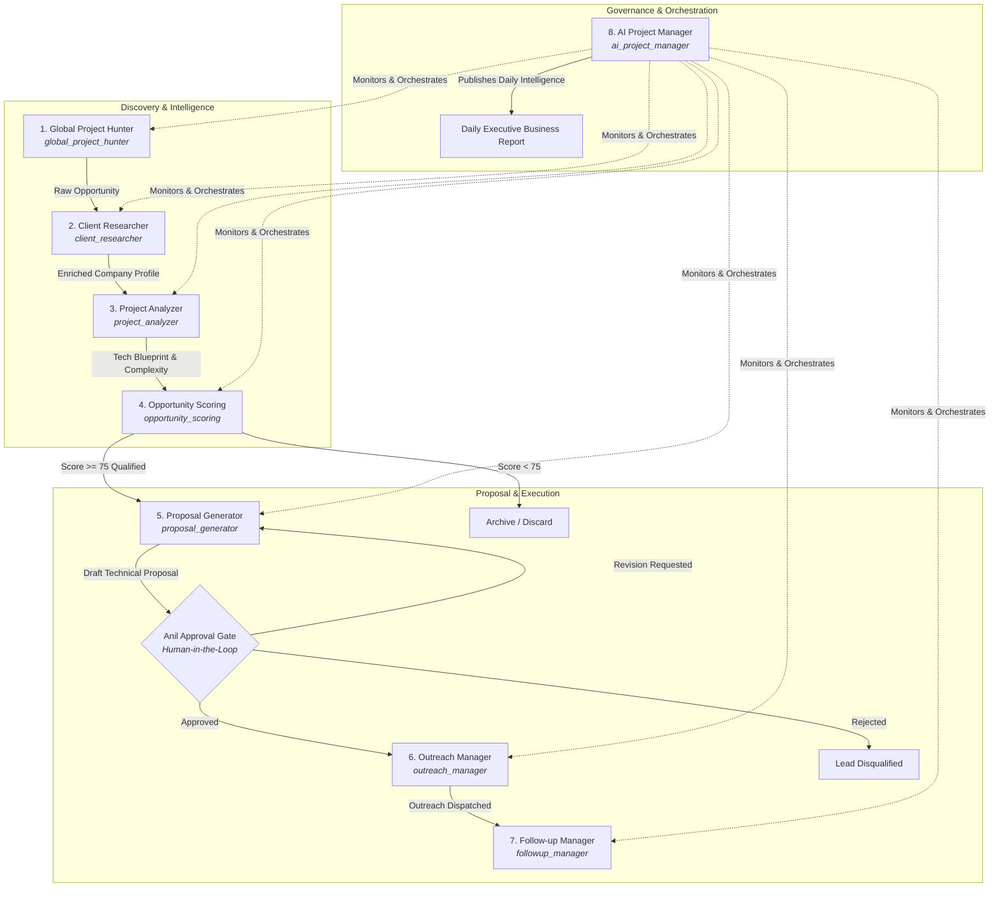

# Nexora AI — Multi-Agent Fleet Specification

This document provides complete technical specifications for the **8 Autonomous AI Agents** powering the **Nexora AI** platform. Each agent operates as a specialized service with defined input contracts, deterministic execution boundaries, telemetry logging, and inter-agent handoff protocols.

---

## 1. Fleet Architecture Overview

---

## 2. Detailed Agent Specifications

### Agent 1: Global Project Hunter (`global_project_hunter`)
- **System Identifier**: `global_project_hunter`
- **Source Module**: `src/lib/projects/agents/hunter/project-hunter.ts`
- **Purpose**: Autonomous discovery of high-value software opportunities across global marketplaces, developer forums, and RSS feeds.
- **Target Quota**: 40 discovered opportunities/day.
- **Responsibilities**:
  - Ingest public job feeds, RFP listings, Reddit boards, GitHub issue boards, and RSS channels.
  - Normalize unstructured job postings into canonical schema format.
  - Sanitize and canonicalize external URLs to prevent duplicate ingest.
  - Execute deduplication hashing across title, client domain, and opportunity description.
- **Input Contract**:
  - `sources`: Array of RSS URLs or target discovery channels.
  - `categoryFilter`: Target software categories (e.g., `ai_machine_learning`, `cloud_devops`, `fullstack`).
- **Processing Logic**:
  1. Feeds are parsed concurrently with exponential-backoff HTTP clients.
  2. Content is cleaned using deterministic DOM stripping and entity normalization.
  3. A SHA-256 fingerprint is calculated on `(source_platform, external_id || normalized_url)` to verify idempotency.
- **Output Contract**:
  - Inserts row into `project_opportunities` with status `discovered`.
  - Dispatches handoff event to `client_researcher`.

---

### Agent 2: Client Researcher (`client_researcher`)
- **System Identifier**: `client_researcher`
- **Source Module**: `src/lib/projects/agents/researcher/client-researcher.ts`
- **Purpose**: Deep investigation and enrichment of client legitimacy, organization structure, and technical ecosystem.
- **Responsibilities**:
  - Extract and validate company domain and hiring stakeholder identities.
  - Perform DNS and WHOIS footprinting to measure organizational maturity.
  - Aggregate employee headcount estimates and engineering job opening trends.
  - Compute a 0–100 **Client Legitimacy Score**.
- **Input Contract**:
  - `opportunityId`: UUID of discovered opportunity.
  - `clientName`, `clientDomain`, `jobDescription`.
- **Processing Logic**:
  1. Identifies corporate domains via regex parsing and MX-record verification.
  2. Queries internal cache and enrichment services to detect corporate tech stack (e.g., AWS, GCP, Next.js, Kubernetes).
  3. Calculates legitimacy metrics: domain age, verified contact emails, corporate social profiles.
- **Output Contract**:
  - Stores enrichment record in `project_opportunities.client_intelligence` (JSONB).
  - Updates `client_legitimacy_score` (integer 0–100).
  - Triggers handoff to `project_analyzer`.

---

### Agent 3: Project Analyzer (`project_analyzer`)
- **System Identifier**: `project_analyzer`
- **Source Module**: `src/lib/projects/agents/analyzer/project-analyzer.ts`
- **Purpose**: Technical requirements decomposition, architectural sizing, and complexity evaluation.
- **Responsibilities**:
  - Extract functional and non-functional requirements from raw project specifications.
  - Classify project scope complexity into `low`, `medium`, `high`, or `enterprise`.
  - Recommend ideal technology stack (languages, frameworks, cloud infra, vector DBs).
  - Estimate delivery duration (e.g., `2-4 weeks`, `2-3 months`).
- **Input Contract**:
  - `opportunityId`: Target project ID.
  - `title`, `description`, `category`, `budgetMin`, `budgetMax`.
- **Processing Logic**:
  - Deterministic NLP parser parses requirement keywords (e.g., "OAuth", "Kafka", "RAG", "Kubernetes").
  - Matches project demands against pre-trained architecture templates.
  - Grades risk factors: unclear scope, legacy integration constraints, tight deadlines.
- **Output Contract**:
  - Writes `analysis_report` JSONB to `project_opportunities`.
  - Sets `scope_complexity` enum and `estimated_duration_weeks`.
  - Hands off to `opportunity_scoring`.

---

### Agent 4: Opportunity Scoring (`opportunity_scoring`)
- **System Identifier**: `opportunity_scoring`
- **Source Module**: `src/lib/projects/agents/scoring/scoring-engine.ts`
- **Purpose**: Strict multi-factor weighted qualification gate ensuring zero wasted engineering hours.
- **Qualification Threshold**: **75 / 100**.
- **Algorithm Breakdown**:
  $$\text{Total Score} = w_1 S_{\text{budget}} + w_2 S_{\text{tech}} + w_3 S_{\text{legitimacy}} + w_4 S_{\text{competition}} + w_5 S_{\text{urgency}}$$
  - **Budget Viability ($w_1 = 0.25$)**: Ratio of client budget to estimated effort hours.
  - **Technical Fit ($w_2 = 0.25$)**: Alignment with agency core competencies (TypeScript, Next.js, AI, Cloud).
  - **Client Legitimacy ($w_3 = 0.20$)**: Score generated by Client Researcher.
  - **Competition Ratio ($w_4 = 0.15$)**: Inverse metric of bidder density or listing age.
  - **Timeline Urgency ($w_5 = 0.15$)**: Immediate hiring demand vs exploratory posts.
- **Output Contract**:
  - Inserts row into `opportunity_scores`.
  - Updates `project_opportunities.qualification_score`.
  - If $\ge 75$: Marks project `qualified` and queues for Proposal Generator.
  - If $< 75$: Marks project `disqualified` with explicit disqualification reasoning.

---

### Agent 5: Proposal Generator (`proposal_generator`)
- **System Identifier**: `proposal_generator`
- **Source Module**: `src/lib/projects/agents/proposal/proposal-generator.ts`
- **Purpose**: Generation of bespoke, high-conversion technical proposals and commercial terms.
- **Responsibilities**:
  - Craft customized executive summaries addressing client pain points directly.
  - Formulate multi-phase milestone deliverables with exact budget allocations totaling 100%.
  - Detail concrete architectural blueprints and acceptance criteria.
- **Input Contract**:
  - Enriched `project_opportunities` record with complete analysis report.
- **Processing Logic**:
  - Uses deterministic technical proposal blueprints or LLM fallback.
  - Validates financial consistency: $\sum \text{Milestone Percentages} == 100\%$.
  - Drafts proposal in state `pending_approval`.
- **Output Contract**:
  - Inserts into `project_proposals` table.
  - Places opportunity into `awaiting_approval` queue in the **Anil Approval Center**.

---

### Agent 6: Outreach Manager (`outreach_manager`)
- **System Identifier**: `outreach_manager`
- **Source Module**: `src/lib/projects/agents/outreach/outreach-generator.ts`
- **Purpose**: Omnichannel outreach dispatching across Email, LinkedIn, and WhatsApp.
- **Safety Policy**: Governed by `ALLOW_EXTERNAL_OUTREACH` environment variable.
- **Responsibilities**:
  - Generate channel-specific messaging:
    - **Email**: Tailored executive pitch with explicit opt-out mechanism.
    - **LinkedIn InMail / Connection**: Strict character limit compliance ($\le 300$ characters).
    - **WhatsApp**: Concise, compliant business messaging.
  - Execute delivery once approved by human operator.
- **Input Contract**:
  - Approved `proposal_id` and stakeholder contact details.
- **Output Contract**:
  - Inserts into `project_outreach_messages`.
  - Dispatches message via configured provider (simulated if `ALLOW_EXTERNAL_OUTREACH !== "true"`).
  - Initiates cadence in `followup_manager`.

---

### Agent 7: Follow-up Manager (`followup_manager`)
- **System Identifier**: `followup_manager`
- **Source Module**: `src/lib/projects/agents/followup/followup-generator.ts`
- **Purpose**: Autonomous, non-intrusive relationship nurturing and response sentiment processing.
- **Cadence Rules**:
  - Step 1: 3 business days post-outreach.
  - Step 2: 5 business days post-step 1.
  - Step 3: 7 business days post-step 2 (Breakup / Graceful close).
  - **Weekend Protection**: Automatically excludes Saturday and Sunday.
- **Response Processing**:
  - Classifies client replies into: `interested`, `more_info_needed`, `not_interested`, `unsubscribed`.
  - Automatically cancels pending follow-ups upon response detection.
- **Output Contract**:
  - Manages `project_followup_sequences` and `project_followup_tasks`.

---

### Agent 8: AI Project Manager (`ai_project_manager`)
- **System Identifier**: `ai_project_manager`
- **Source Module**: `src/lib/projects/agents/project-manager/project-manager.ts`
- **Purpose**: System governor, orchestrator, execution monitor, and executive dashboard controller.
- **Responsibilities**:
  - Fleet Telemetry: Tracks latency, error rates, and API token burn across all 7 operational agents.
  - Concurrency & Lock Management: Uses advisory execution locks to avoid duplicate pipeline runs.
  - Failure Recovery: Implements exponential retry policies for transient network or database exceptions.
  - Anil Approval Center: Serves pending proposals and outreach tasks to human operators.
  - Daily Business Intelligence: Generates daily executive reports (`daily_business_reports`).
- **Telemetry & Logging**:
  - Logs every run to `agent_executions` with execution status (`success`, `failed`, `in_progress`), latency in ms, and payload snapshot.
