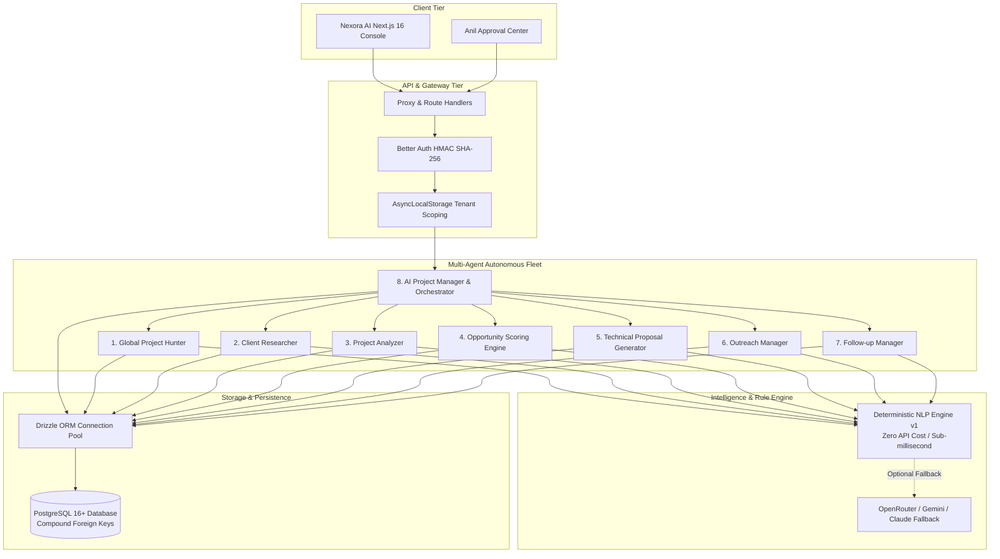
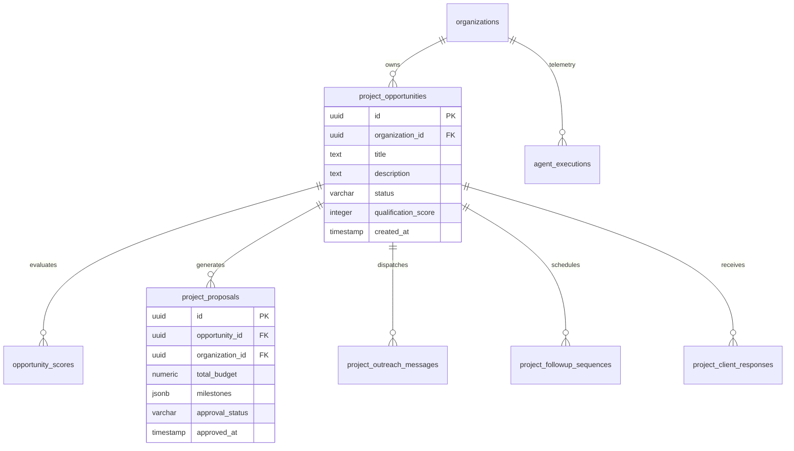

# Nexora AI — System Architecture Specification

**Nexora AI** is an enterprise-grade Autonomous Multi-Agent Automation Platform built on Next.js 16 (App Router), TypeScript, and PostgreSQL (accessed via Drizzle ORM). It coordinates 8 specialized AI agents to discover, qualify, analyze, propose, and execute client outreach with strict human-in-the-loop governance.

---

## 1. High-Level System Architecture

---

## 2. The 8 Autonomous Agents

The multi-agent system divides business development into modular, testable stages:

1. **`global_project_hunter`**: Ingests project opportunities across RSS feeds, job boards, and public forums, filtering and sanitizing external URLs to guarantee idempotency.
2. **`client_researcher`**: Validates organizational domains, profiles technological footprints, and calculates a 0–100 credibility metric.
3. **`project_analyzer`**: Extracts technical requirements, classifies project complexity (`low`, `medium`, `high`, `enterprise`), and recommends software architectures.
4. **`opportunity_scoring`**: Evaluates opportunities against a weighted multi-factor scoring algorithm (threshold: 75/100).
5. **`proposal_generator`**: Produces commercial and technical proposals with verified 100% milestone financial allocations.
6. **`outreach_manager`**: Creates channel-tailored outreach copy (Email, LinkedIn $\le 300$ chars, WhatsApp) guarded by `ALLOW_EXTERNAL_OUTREACH`.
7. **`followup_manager`**: Maintains a 3-step cadence (3, 5, 7 business days) skipping weekends and handling incoming client responses.
8. **`ai_project_manager`**: Oversees fleet telemetry, manages advisory execution locks, catches failures, and delivers executive dashboards.

---

## 3. Database Schema Architecture

The persistence model enforces strict compound tenant isolation:

---

## 4. Transparent Deterministic NLP Engine

To eliminate unpredictable token expenses, latency spikes, and hallucinations during high-volume qualification, Nexora AI incorporates `nexgen-deterministic-nlp-v1`:
- **Zero Token Cost**: Operates entirely in-memory with sub-millisecond execution.
- **Predictable Rule Sets**: Uses structured heuristic classifiers, keyword frequency maps, and entity extraction regex.
- **Optional LLM Fallback**: Seamlessly queries external LLMs (via OpenRouter or direct APIs) only when unstructured confidence scores drop below calibrated thresholds.
