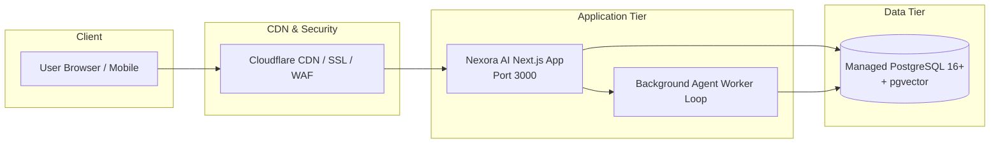

# Nexora AI — Production Deployment Guide

This guide covers production deployment strategies for **Nexora AI**, including **Render**, **Docker Compose**, and **Linux VPS / Cloud VM** configurations.

---

## 1. Deployment Architecture



---

## 2. Deploying on Render

Render is an ideal managed cloud platform for Nexora AI with zero DevOps maintenance.

### Step 1: Provision Managed PostgreSQL
1. Log in to the [Render Dashboard](https://dashboard.render.com).
2. Click **New +** $\rightarrow$ **PostgreSQL**.
3. Settings:
   - **Name**: `nexora-ai-db`
   - **Database**: `nexora_ai`
   - **User**: `nexora`
   - **PostgreSQL Version**: `16`
   - **Plan**: Standard or Starter
4. Copy the **Internal Database URL**.

### Step 2: Deploy Web Service
1. In Render, click **New +** $\rightarrow$ **Web Service**.
2. Connect your GitHub repository: `https://github.com/Anilbirada/Nexora-AI-Intelligent-Multi-Agent-Automation-Platform`.
3. Configuration:
   - **Environment**: `Node`
   - **Branch**: `main`
   - **Build Command**: `npm install && npm run build`
   - **Start Command**: `npm run start`
   - **Plan**: Starter or Standard ($1\text{ GB}+$ RAM recommended)

### Step 3: Configure Environment Variables
Under the service's **Environment** tab, set:

| Variable | Value |
|:---|:---|
| `NODE_ENV` | `production` |
| `DATABASE_URL` | *Paste Render Internal Database URL* |
| `DATABASE_SSL` | `require` |
| `BETTER_AUTH_URL` | `https://your-service-name.onrender.com` |
| `NEXT_PUBLIC_APP_URL` | `https://your-service-name.onrender.com` |
| `BETTER_AUTH_SECRET` | *32-byte hex generated via `openssl rand -hex 32`* |
| `ALLOW_EXTERNAL_OUTREACH` | `false` *(Set to `true` only when ready for live outreach)* |
| `ANIL_APPROVAL_EMAIL` | `anil@nexora.ai` |

### Step 4: Database Schema Initialization
Run a one-time database setup task via Render Shell or SSH:
```bash
npm run db:setup
```

---

## 3. Deploying with Docker Compose

For on-premise, AWS EC2, or VPS self-hosting:

```yaml
version: '3.8'

services:
  db:
    image: postgres:16-alpine
    container_name: nexora-db
    restart: always
    environment:
      POSTGRES_USER: nexora
      POSTGRES_PASSWORD: ${POSTGRES_PASSWORD:-change-me-secure-password}
      POSTGRES_DB: nexora_ai
    volumes:
      - nexora_pgdata:/var/lib/postgresql/data
    ports:
      - "5432:5432"

  app:
    build: .
    container_name: nexora-app
    restart: always
    depends_on:
      - db
    environment:
      NODE_ENV: production
      DATABASE_URL: postgres://nexora:${POSTGRES_PASSWORD:-change-me-secure-password}@db:5432/nexora_ai
      DATABASE_SSL: disable
      BETTER_AUTH_URL: ${APP_URL:-http://localhost:3000}
      NEXT_PUBLIC_APP_URL: ${APP_URL:-http://localhost:3000}
      BETTER_AUTH_SECRET: ${BETTER_AUTH_SECRET}
      ALLOW_EXTERNAL_OUTREACH: "false"
      ANIL_APPROVAL_EMAIL: "anil@nexora.ai"
    ports:
      - "3000:3000"

volumes:
  nexora_pgdata:
```

### Launch Command:
```bash
docker compose up -d --build
```

---

## 4. Production Health Checks & Monitoring

The system exposes an automated health probe at:
`GET /api/project-manager/health`

**Expected Response**:
```json
{
  "status": "healthy",
  "database": "connected",
  "pool": {
    "active": 2,
    "idle": 6
  },
  "scheduler": "running",
  "timestamp": "2026-11-11T12:00:00.000Z"
}
```
Configure your load balancer or uptime monitor (e.g., Uptime Kuma, Better Stack) to ping this route every 60 seconds.
