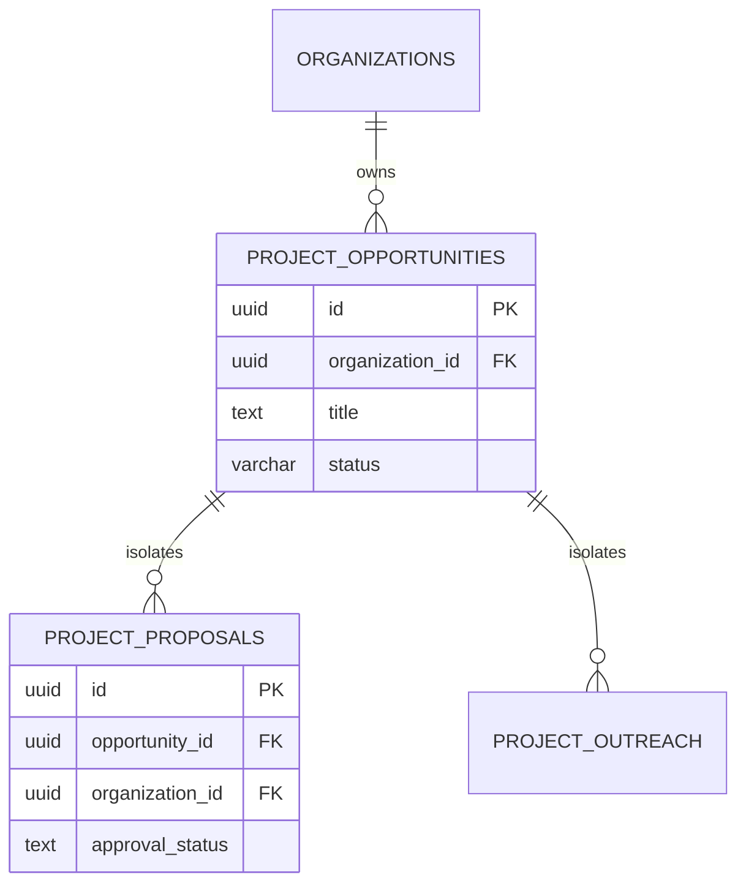

# Nexora AI — Enterprise Security & Isolation Specification

Security, tenant isolation, and deterministic safety are core architectural pillars of **Nexora AI**. This document details our defense-in-depth model.

---

## 1. Multi-Tenant Compound Isolation

All core database tables enforce compound foreign key scoping using both the object identifier and the tenant's `organization_id`:

### Database Security Guarantees:
1. **Zero Cross-Tenant Leakage**: Every query within `src/lib/projects` evaluates `where(and(eq(table.id, id), eq(table.organizationId, orgId)))`.
2. **Context Scoping**: Tenant context is resolved server-side through `requireOrgContext()` and propagated via Node.js `AsyncLocalStorage`.
3. **Compound Foreign Keys**: Child tables declare `foreignKey({ columns: [table.opportunityId, table.organizationId], foreignColumns: [parent.id, parent.organizationId] })`.

---

## 2. Authentication & Session Architecture

- **Engine**: Better Auth with PostgreSQL session persistence.
- **Tokens**: Signed using HMAC SHA-256 with `BETTER_AUTH_SECRET`.
- **Cookies**: Enforce `HttpOnly`, `SameSite=Lax` (or `Strict`), and `Secure` flags in production.
- **RBAC**: Three-tier role hierarchy: `owner`, `admin`, `member`. Approval actions are restricted to `owner` and `admin` roles.

---

## 3. Human-in-the-Loop Governance: Anil Approval Gate

To eliminate unauthorized outreach and protect sender reputation:
1. **Safety Switch (`ALLOW_EXTERNAL_OUTREACH`)**:
   - When set to `false`, the platform dispatches zero network packets to external email, LinkedIn, or WhatsApp recipients.
   - All dispatches are executed in **Simulation Mode** and recorded in telemetry logs with payload snapshots.
2. **Mandatory Human Signoff**:
   - High-value proposals generated by AI are flagged as `pending_approval`.
   - Outreach generation routes reject dispatches until a designated administrator (e.g., `ANIL_APPROVAL_EMAIL`) issues an explicit `approve` command.

---

## 4. Credential Encryption at Rest

1. Third-party integrations (Unipile, Google OAuth, custom SMTP) do not store raw tokens in plaintext.
2. Tokens are symmetrically encrypted using AES-256-GCM before database insertion.
3. Decryption keys are derived from `BETTER_AUTH_SECRET` and are never exposed to browser runtimes.

---

## 5. Security Checklist for Deployments

- [x] Run with `DATABASE_SSL=require` when connecting across public networks.
- [x] Rotate `BETTER_AUTH_SECRET` using a minimum 256-bit cryptographically secure random generator.
- [x] Verify `.env`, `.env.local`, and test data files are explicitly ignored in `.gitignore`.
- [x] Set `ALLOW_EXTERNAL_OUTREACH=false` during staging and pilot evaluations.
- [x] Maintain automated test coverage verification before every production merge.
