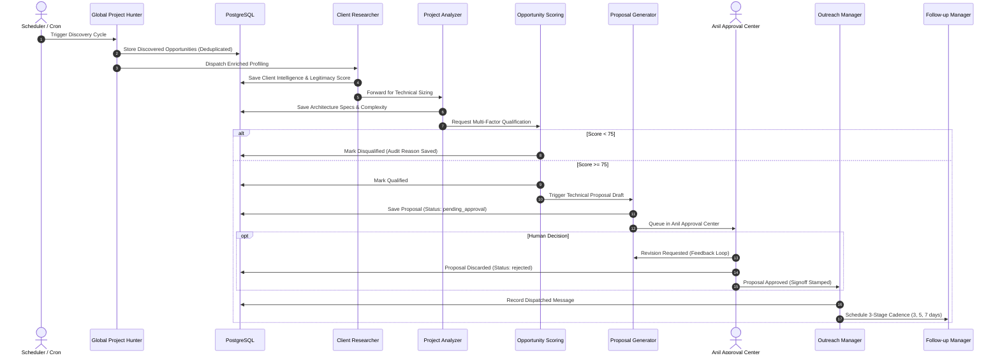
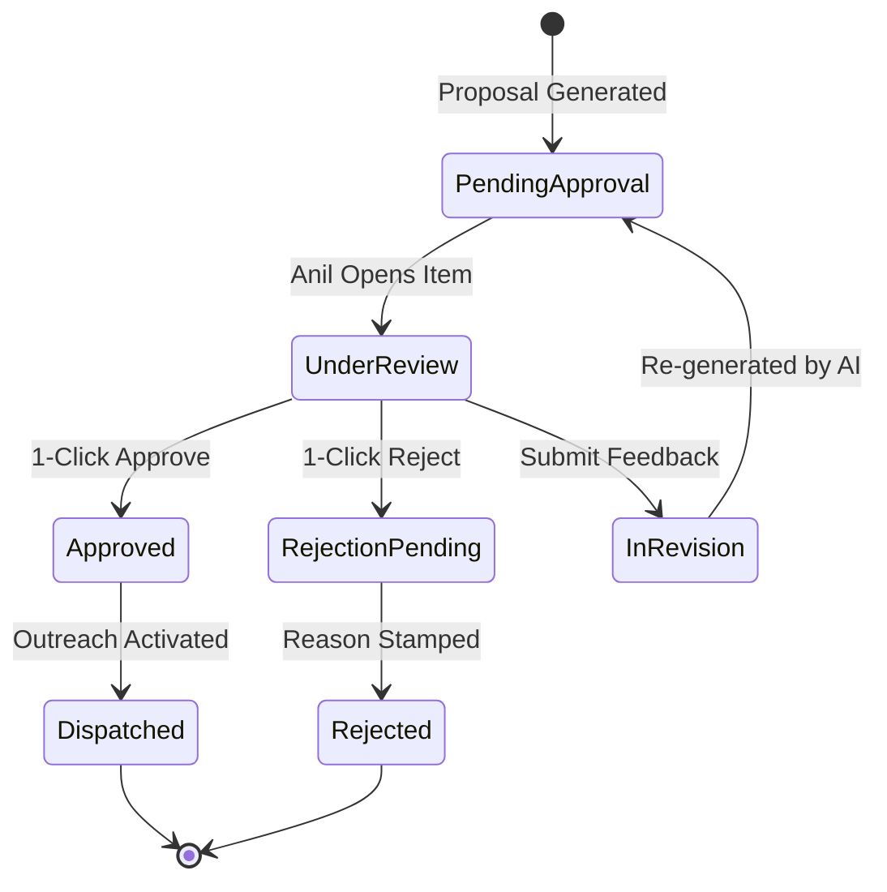

# Nexora AI — Multi-Agent Workflow Documentation

This document describes the end-to-end execution workflows of **Nexora AI**, detailing stage transitions, decision branches, human-in-the-loop safeguards, and exception recovery mechanisms.

---

## 1. End-to-End Pipeline Workflow

---

## 2. Discovery & Qualification Phase

### Step 1: Ingestion & URL Canonicalization
1. The `global_project_hunter` fetches external feeds on a configured interval (every 10 minutes or manual dispatch).
2. For each raw listing:
   - Query parameters such as `utm_*`, `ref`, and tracking cookies are stripped.
   - External IDs are extracted.
   - Hashing prevents collision:
     $$\text{Hash} = \text{SHA-256}(\text{source} + \text{canonical\_url})$$
   - Existing hashes in `project_opportunities` are bypassed immediately without database write amplification.

### Step 2: Legitimacy Footprinting
1. `client_researcher` checks whether the organization is an existing client in the `companies` table.
2. If new, DNS records, domain reputation, and social footprints are evaluated.
3. If legitimacy score falls below 30, the lead is immediately flagged as high risk.

### Step 3: Architectural Decomposition
1. `project_analyzer` parses technical keywords and separates deliverables into tiers:
   - **Frontend**: Next.js, React, Tailwind CSS, TypeScript.
   - **Backend**: Node.js, Python, PostgreSQL, Redis, Drizzle ORM.
   - **AI/ML**: Agentic frameworks, LangChain, RAG pipelines, Vector embeddings.
   - **Cloud**: AWS, GCP, Docker, Kubernetes.
2. Timeline requirements and team size requirements are calculated.

### Step 4: Multi-Factor Scoring Gate
1. Weighted scoring executes against the 5 criteria:
   - Budget Viability (25%)
   - Technical Competency Fit (25%)
   - Client Legitimacy (20%)
   - Competition Saturation (15%)
   - Hiring Urgency (15%)
2. Opportunities scoring $\ge 75$ are immediately promoted to `qualified`.

---

## 3. Human-in-the-Loop: Anil Approval Gate

To maintain absolute brand reputation, eliminate AI hallucinations, and prevent unauthorized client commitments, Nexora AI enforces the **Anil Approval Gate**:

### Governance Rules:
1. **Zero Automated External Communication**: No external email, LinkedIn message, or WhatsApp text can be transmitted without explicit approval status.
2. **Approval Metadata Recorded**: The approving user ID, timestamp, and optional adjustments are permanently recorded in `project_proposals.approved_by` and `project_proposals.approved_at`.
3. **Safety Fallback**: If `ALLOW_EXTERNAL_OUTREACH !== "true"`, the system executes all outbound routines in **Simulation Mode** — writing to logs and tracking events without dispatching physical network packets.

---

## 4. Outreach & Follow-up Cadence Workflow

Once approved:
1. **Channel Selection**:
   - Primary: Verified Business Email (SPF/DKIM checked).
   - Secondary: LinkedIn InMail / Connection Request (character limit validated $\le 300$).
   - Direct: WhatsApp Business API (where opt-in confirmed).
2. **Cadence Automation**:
   - **Initial Outreach**: Sent on approval.
   - **Follow-up 1 (Day +3)**: Value-add insight or case study reference.
   - **Follow-up 2 (Day +8)**: Architecture overview or executive offer.
   - **Follow-up 3 (Day +15)**: Graceful breakup closing the loop.
3. **Calendar Skipping**:
   - The scheduler computes `target_date` using business day math, automatically skipping Saturdays and Sundays.

---

## 5. Inbound Response Processing & CRM Sync

When a recipient responds to an outreach thread:
1. Inbound webhook or mailbox synchronization captures the message content.
2. The deterministic sentiment engine analyzes the reply:
   - `interested`: Creates deal in CRM, alerts executive via notification, halts sequence.
   - `more_info_needed`: Queues project analyzer for additional technical details.
   - `not_interested`: Sets sequence to terminated, records objection for analytics.
   - `unsubscribed`: Blacklists domain across all organization campaigns instantly.
